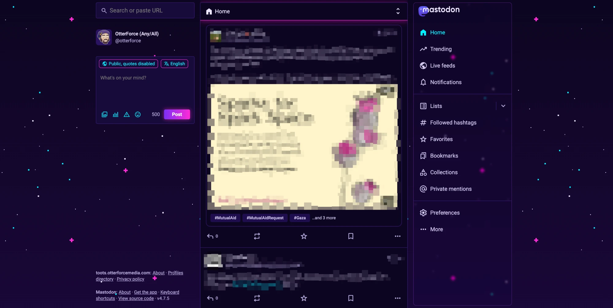

# Mastodon Synthwave Theme

Custom CSS for a Mastodon instance: cyan, purple and magenta, with a slow
8-bit starfield behind the page and a frosted right sidebar.

Tested on Mastodon 4.7.5.

## Install

1. Copy the contents of `synthwave.css`.
2. In the admin area, go to **Administration → Server settings → Appearance**.
3. Paste into **Custom CSS** and save.

Set your own appearance to **Dark**. The CSS forces the dark scheme on
logged-out pages too.

## Tweaks

- Star drift speed: the `80s` in the `animation` line. Higher is slower.
- Sidebar tint and blur: `30%` and `3px` in the frosted-sidebar rule.
- The glass and see-through rules only apply at 760px and wider.

## License

[MPL-2.0](LICENSE). Changes to `synthwave.css` that you share must stay under the same license.
